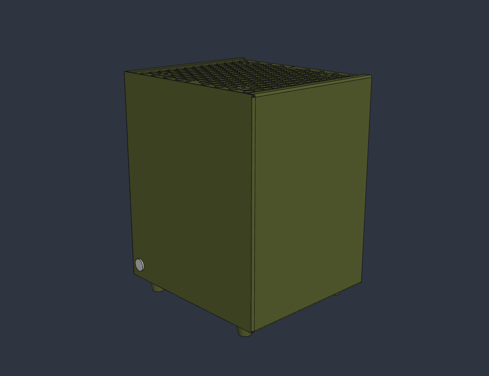
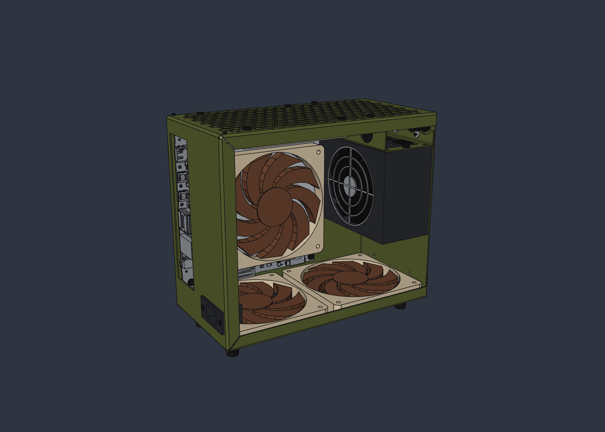

# Reactor

A small, quiet mini-ITX case for boards that have all their graphics on the
CPU.

This project is at an early stage: a sheet metal design that is close to
orderable, and a first airflow and heat study. None has been built yet.

Each design is a mark with its own branch. The Mk I, on `mk-i`, is the first:
folded sheet metal. A change of material or layout big enough to start over
becomes the Mk II on a branch of its own.

## Why

I have liked small form factor PCs for a long time. My early builds ran on
integrated graphics, then on AMD's APUs through Trinity, Richland and Kaveri,
because I loved the idea of a small machine with all the power it needed on
one chip. They weren't good enough yet, so I went back to small builds with a
graphics card.

The last of those was in a KXRORS M02 SFX. It took standard parts: a full
sized ATX power supply, a normal sized graphics card and a large CPU heatsink.
Because it fit large fans and a full sized power supply it was very quiet, and
there was no wasted space anywhere in it.

The Ryzen AI Max series is the chip I always wanted. I now run a Framework
Desktop mainboard (Ryzen AI Max 385, 32 GB) in a COOJ MQ4, and it is faster
than that last graphics card build. The case fans are a Noctua NF-A12x15 PWM
on the CPU heatsink and two Thermalright TL-8015s in the top, and as far as I
can tell they are stopped or turning slowly most of the time.

The problem is the power supply. The MQ4 takes FlexATX, and the fan in the
Enhance ENP-8345L is far too loud, loud enough that I can't hear what the rest
of the machine is doing. The 350 W Enhance unit the case came with was the
same. I started on a quieter FlexATX supply,
[Nova Reactor](https://github.com/OptimoSupreme/nova-reactor), but that is
turning into a much bigger job than expected and may not end up much quieter
than the best FlexATX units already on sale. A case built around a power
supply with a larger fan goes at the same problem from the other side.

## Goals

Quiet, small and cool come first. Where another goal conflicts with those
three, they win.

- Mini-ITX.
- Quiet enough that no fan stands out, the power supply's included, at idle
  and under a gaming load.
- As small as the parts allow.
- Good thermal performance, with airflow from bottom to top in the manner of
  the cylindrical Mac Pro: intake underneath, exhaust out of the top. The
  shape is not decided, and it is not round for now.
- No large empty voids. Every part of the volume is either a component or an
  air path.
- Standard parts throughout, with large, slow fans wherever a fan is needed.
- An ATX or SFX power supply, for the larger and quieter fans they have over
  FlexATX.
- No PCIe expansion slots and no room for a graphics card.
- Fits the Framework Desktop mainboard with the Ryzen AI Max 385 and meets its
  cooling needs, with room and thermal headroom for the boards that follow
  it. The next upgrade is likely to be a Medusa Halo board, possibly with the
  top chip in the range, so the cooling is sized for more than the 385 needs.
- No ports on the case itself, only a power button.

## Where things are

- [mechanical/mk1.py](mechanical/mk1.py) builds the Mk I in SolidCraft, as
  two designs. [mechanical/reactor-mk-i.sc](mechanical/reactor-mk-i.sc) is
  the sheet metal alone, which is what a shop makes.
  [mechanical/export/](mechanical/export/) has what a shop quotes from: a
  STEP model, a flat pattern and a bend table for each part, and
  [the drawings](mechanical/export/reactor-mk-i-drawings.pdf), which
  [mechanical/drawings.py](mechanical/drawings.py) draws. The second design
  is the whole machine: the same parts with Framework's own model of the
  mainboard, the fans, the supply and every screw, nut and stud in place,
  for looking at and for checking that nothing clashes. Framework's model is
  73 MB, so it and that design are kept outside the repo.

  

  The layout follows the KXRORS M02: the board on a tray against one side
  wall, an SFX supply standing in front of it with its fan toward the board
  and its exhaust upward, two slim 120 mm fans in the bottom and one in the
  top. It is five parts in 1.2 mm steel: a core (bottom, rear and top), the
  tray, a bulkhead across the front that carries the supply's weight to the
  floor, a shelf that the supply hangs under, and a plain shell (front and
  sides). The tray and the bulkhead are spot welded to the core. The shelf
  comes out with the supply on it: it hangs on three studs in the bulkhead
  and two screws through the top panel. The shell slides on from the front,
  slots in its flanges running onto screw heads at three rear corners, and
  one small screw underneath at the fourth holds it there. Apart from the
  fan screws, the mains inlet's and the shell's, every screw is the 6-32
  kind used all over PC cases.
- [docs/before-ordering.md](docs/before-ordering.md) lists what has been
  checked and what is still open before one can be ordered.
- [docs/parts.md](docs/parts.md) has the dimensions of the bought-in parts and
  where each came from, and says which are still placeholders.
- [sim/airflow.py](sim/airflow.py) runs the airflow and heat study in
  FieldCraft, and [docs/thermal.md](docs/thermal.md) has what it found and
  what that means for temperatures and noise.
- [mechanical/layout-study.sc](mechanical/layout-study.sc) is the box study
  the layout was chosen from.

## License

Copyright 2026 Justin Ward.

Reactor is open hardware, licensed under the CERN Open Hardware Licence
Version 2 - Strongly Reciprocal (CERN-OHL-S v2). You may redistribute and modify
it, and make products from it, under the terms in [LICENSE](LICENSE). If you
distribute a modified design or products built from it, you must publish your
complete design sources under the same licence.

Source location: https://github.com/OptimoSupreme/reactor

It is distributed without any express or implied warranty, including of
merchantability, satisfactory quality and fitness for a particular purpose.

The Framework Desktop mainboard dimensions come from Framework Computer's
published drawings, which are CC BY 4.0.
