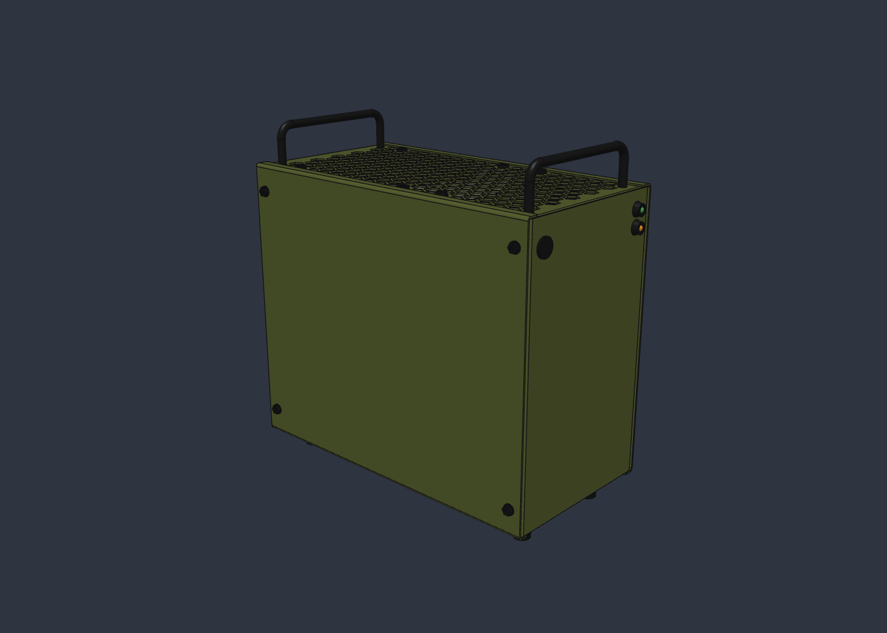
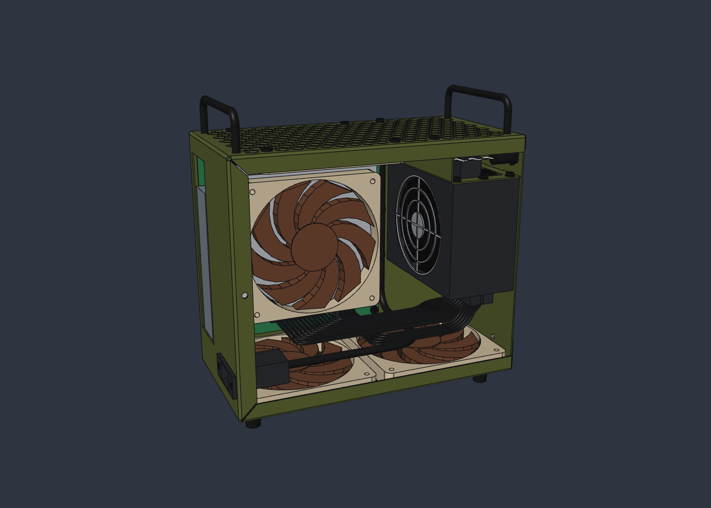
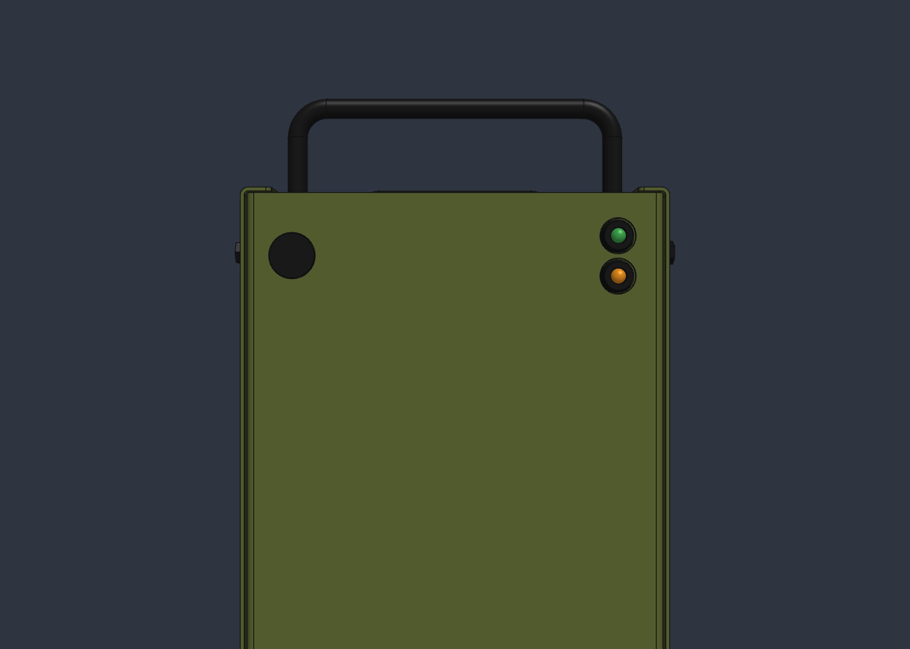
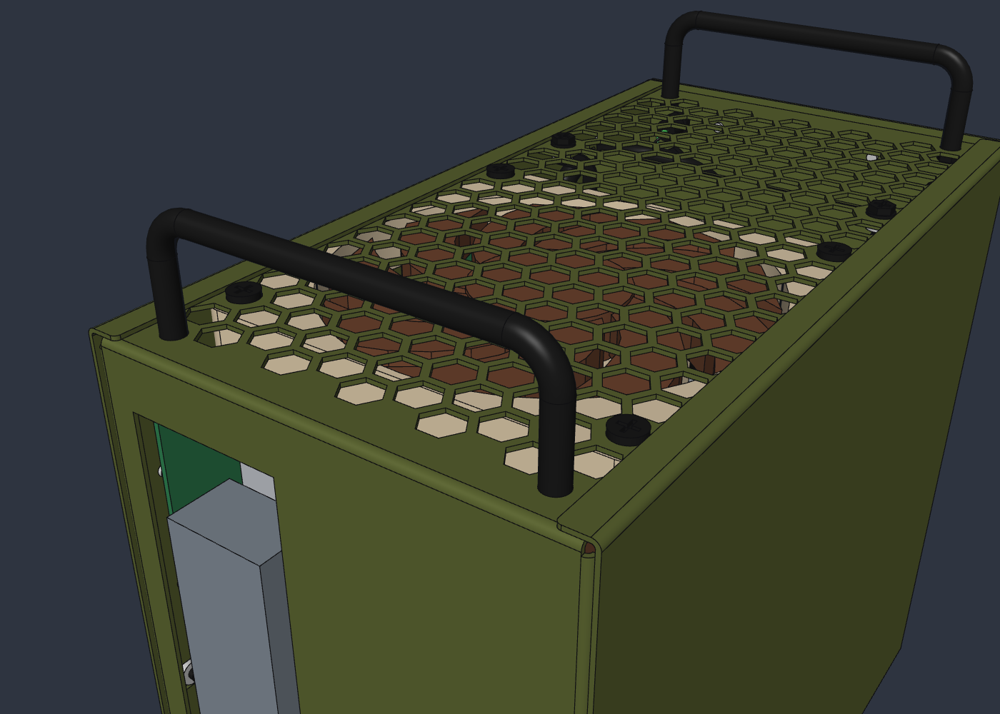

# Reactor

A small, quiet mini-ITX case for boards that have all their graphics on the
CPU.

It is drawn and checked and close to orderable, in folded sheet metal:
255 x 134 x 216 mm without its feet and handles, 7.4 litres, for an SFX power supply.
None has been built yet, so everything here is a model and a simulation.

## Why

I have liked small form factor PCs for a long time. My early builds ran on
integrated graphics, then on AMD's APUs through Trinity, Richland and Kaveri,
because I loved the idea of a small machine with all the power it needed on
one chip. They weren't good enough yet, so I went back to small builds with a
graphics card.

The last of those was in a KXRORS M02 SFX. It took standard parts: a full
sized ATX power supply, a normal sized graphics card and a large CPU heatsink.
Because it fit large fans and a full sized power supply it was very quiet, and
there was no wasted space anywhere in it.

The Ryzen AI Max series is the chip I always wanted. I now run a Framework
Desktop mainboard (Ryzen AI Max 385, 32 GB) in a COOJ MQ4, and it is faster
than that last graphics card build. The case fans are a Noctua NF-A12x15 PWM
on the CPU heatsink and two Thermalright TL-8015s in the top, and as far as I
can tell they are stopped or turning slowly most of the time.

The problem is the power supply. The MQ4 takes FlexATX, and the fan in the
Enhance ENP-8345L is far too loud, loud enough that I can't hear what the rest
of the machine is doing. The 350 W Enhance unit the case came with was the
same. I started on a quieter FlexATX supply,
[Nova Reactor](https://github.com/OptimoSupreme/nova-reactor), but that is
turning into a much bigger job than expected and may not end up much quieter
than the best FlexATX units already on sale. A case built around a power
supply with a larger fan goes at the same problem from the other side.

## Goals

Quiet, small and cool come first. Where another goal conflicts with those
three, they win.

- Mini-ITX.
- Quiet enough that no fan stands out, the power supply's included, at idle
  and under a gaming load.
- As small as the parts allow.
- Good thermal performance, with airflow from bottom to top in the manner of
  the cylindrical Mac Pro: intake underneath, exhaust out of the top. The
  shape is not decided, and it is not round for now.
- No large empty voids. Every part of the volume is either a component or an
  air path.
- Standard parts throughout, with large, slow fans wherever a fan is needed.
- An ATX or SFX power supply, for the larger and quieter fans they have over
  FlexATX.
- No PCIe expansion slots and no room for a graphics card.
- Fits the Framework Desktop mainboard with the Ryzen AI Max 385 and meets its
  cooling needs, with room and thermal headroom for the boards that follow
  it. The next upgrade is likely to be a Medusa Halo board, possibly with the
  top chip in the range, so the cooling is sized for more than the 385 needs.
- No ports on the case itself, only a power button and two lamps.

## Where things are

- [mechanical/reactor.py](mechanical/reactor.py) builds it in SolidCraft, as
  two designs. [mechanical/reactor.sc](mechanical/reactor.sc) is
  the sheet metal alone, which is what a shop makes.
  [mechanical/export/](mechanical/export/) has what a shop quotes from: a
  STEP model, a flat pattern and a bend table for each part, and
  [the drawings](mechanical/export/reactor-drawings.pdf), which
  [mechanical/drawings.py](mechanical/drawings.py) draws, with the foot on
  their last sheet.
  `reactor-low-detail.sc`
  is the whole machine: the same parts with the fans, the supply, the
  handles and every screw, nut and stud in place, and the mainboard drawn as
  a block, for looking at and for checking that nothing clashes. It has the mains
  lead and every wire of the power, switch and lamp cables drawn in it, which
  makes it about 70 MB, so it is not committed: reactor.py builds it beside
  the sheet metal design.

  

  The layout follows the KXRORS M02: the board on a tray against one side
  wall, an SFX supply standing in front of it with its fan toward the board
  and its exhaust upward, two slim 120 mm fans in the bottom and one in the
  top. The supply's place follows Intel's SFX12V guide, so any SFX unit that
  keeps to it should fit; the two it was laid out around are Corsair's SF450
  and Seasonic's Focus SGX-550 (2021). It is six pieces of 1.2 mm steel: a core (bottom and rear), a hood (top
  and front), the tray, a shelf that the supply hangs under, and two side
  panels, which are the same part. No part is a deep U, which a
  press brake cannot fold. The hood slides on from the front: its top lies
  on a lip of the rear panel, where the rear handle's screws clamp it, and
  a return at the foot of its front goes under the bottom panel, where the
  front fan's two front screws hold it. The tray is riveted to the core and
  the hood by hand with flush rivets. The shelf comes out with the
  supply on it: four screws through the top hold it, and nothing stands
  over the supply's own screws when it is out. Four pairs of slots in the tray, between the
  board and the supply, take cable ties. The front has a flange down each
  side, folded back inside the side panels, as the rear panel has. Each
  side panel has a flange over the top and one under the bottom,
  and four ordinary case screws, one near each corner, into the rear panel's
  lips and the front's flanges; with them out it lifts straight off. Two
  black handles of bent 1/4 in rod cross the top, one at the rear and one at
  the front, each leg held by a case screw from underneath. On the front,
  the power button sits under one leg of the front handle and two lamps
  under the other, green for power over amber for drive activity, all three
  fixed in the front itself. Four steel
  feet, printed and tapped, turn onto studs under the bottom panel. Apart
  from the fan screws and the mains inlet's two, every screw is the one 6-32
  case screw, feet and handles included, so a single Phillips driver opens
  the case and takes out the shelf and the supply.

  

  
- [mechanical/dfm.py](mechanical/dfm.py) measures every cut-out in the flat
  patterns against the shop's rules, and
  [mechanical/renders.py](mechanical/renders.py) redraws the pictures in
  [docs/images/](docs/images/) from the assembly.
- [docs/before-ordering.md](docs/before-ordering.md) lists what has been
  checked and what is still open before one can be ordered.
- [docs/parts.md](docs/parts.md) has the dimensions of the bought-in parts,
  the fasteners and where each figure came from.
- [sim/airflow.py](sim/airflow.py) runs the airflow and heat study in
  FieldCraft, and [docs/thermal.md](docs/thermal.md) has what it found. In
  short: the CPU cooler breathes room air, the present board flat out
  should sit at about 75 to 85 °C with the fans turned well down, and the
  supply, which breathes the heatsink's exhaust, is the part most likely to
  be heard.
- [mechanical/layout-study.sc](mechanical/layout-study.sc) is the box study
  the layout was chosen from.

## License

Copyright 2026 Justin Ward.

Reactor is open hardware, licensed under the CERN Open Hardware Licence
Version 2 - Strongly Reciprocal (CERN-OHL-S v2). You may redistribute and modify
it, and make products from it, under the terms in [LICENSE](LICENSE). If you
distribute a modified design or products built from it, you must publish your
complete design sources under the same licence.

Source location: https://github.com/OptimoSupreme/reactor

It is distributed without any express or implied warranty, including of
merchantability, satisfactory quality and fitness for a particular purpose.

The Framework Desktop mainboard dimensions come from Framework Computer's
published drawings, which are CC BY 4.0.
