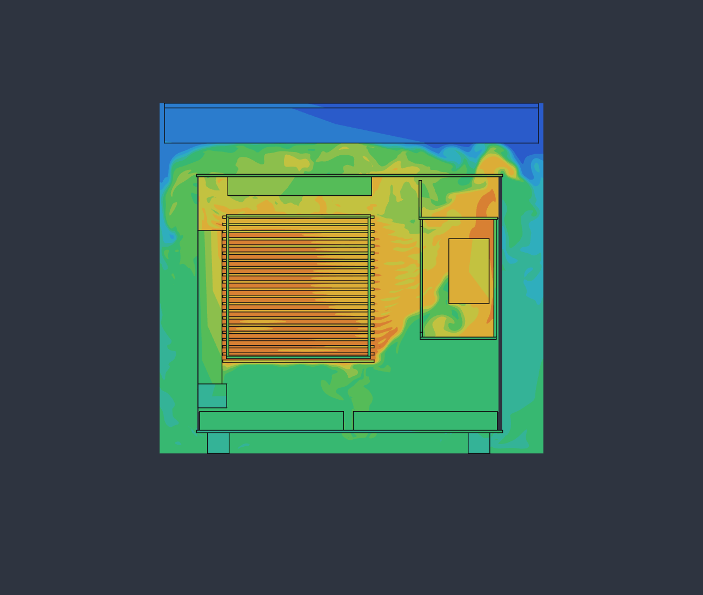
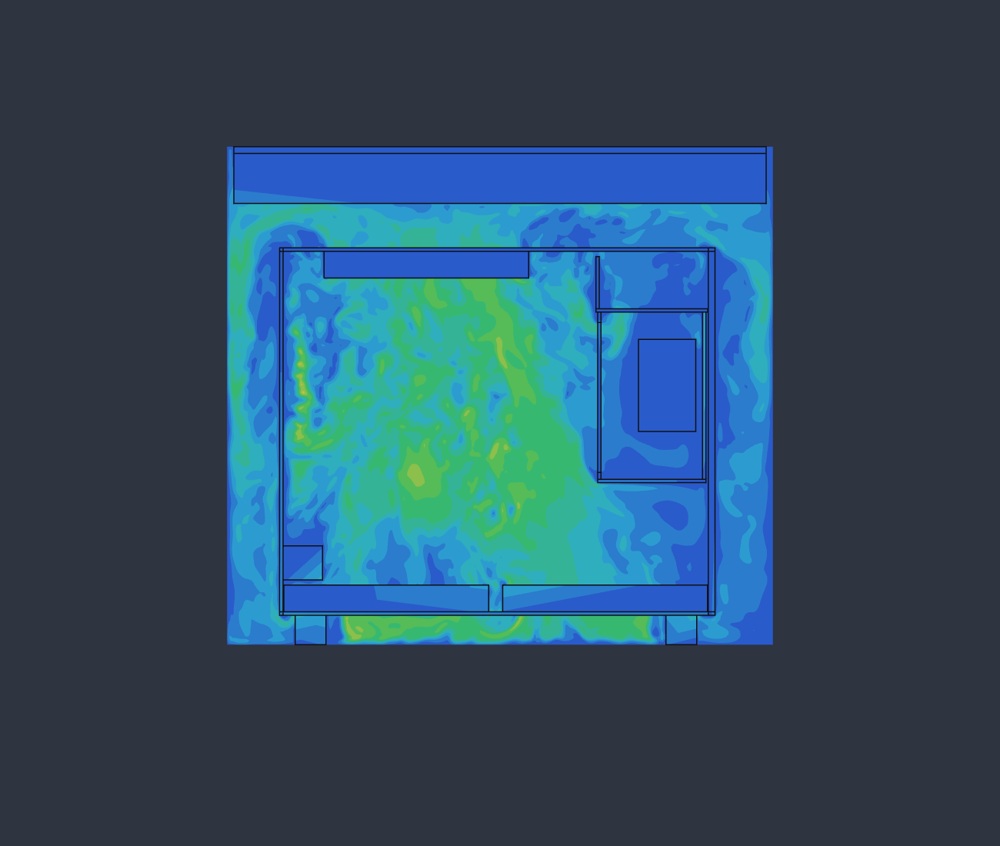
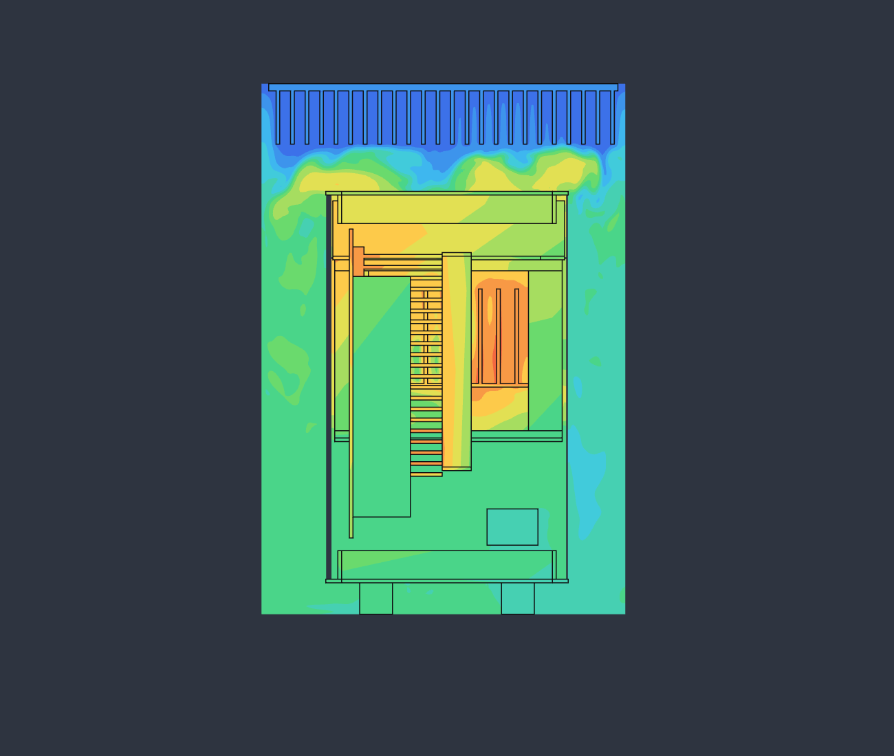
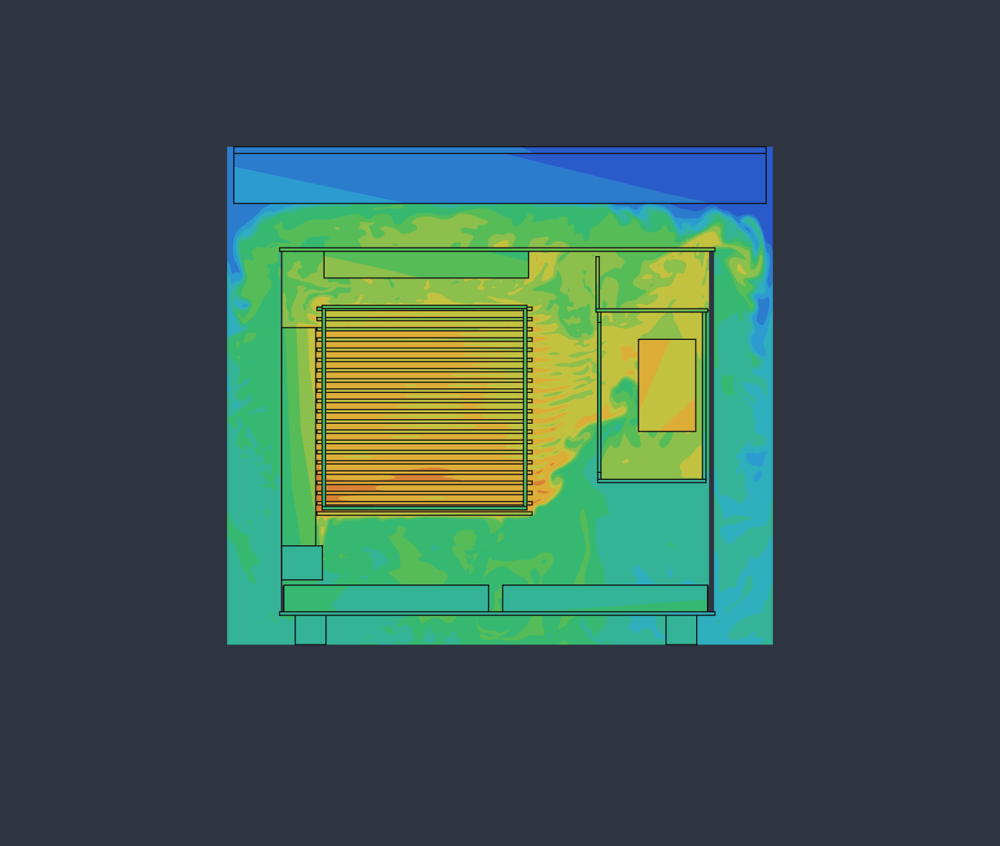

# Cooling and noise

What the airflow and heat study found, and what it means for temperatures and
noise. Nothing here has been measured on a built case: these are simulation
results and estimates from published figures, and each says which it is.
Updated 2026-11-12.

## The short answer

- The CPU cooler breathes room air. At full load with the case fans at half
  speed, the air reaching the heatsink fan is within a degree of the room.
  The case does not make the CPU run hotter than the same cooler in the open.
- The present board at its 140 W limit should sit at roughly 75 to 85 °C with
  the fans turned well down, against a limit of 100 °C. That is an estimate,
  not a simulated figure; see below.
- With the fans at those speeds the four of them together come to about
  16 dBA at a metre by Noctua's figures, before the mesh and the case add
  their share. The supply's fan should be stopped most of the time, but that
  is the least certain part: see the next point.
- A hotter chip is a question for its heatsink, not the case. With 180 W in
  the present heatsink and every fan flat out the cooler still gets room air,
  but the chip would be near its limit and the fans at about 30 dBA.
- The supply is downstream of the heatsink and breathes its exhaust: 43 °C at
  its fan with the present board flat out. That is inside its 50 °C rating,
  but its fan is controlled by temperature as well as load and may turn at
  lower loads than Corsair's 300 W figure suggests.

## What was run

[sim/airflow.py](../sim/airflow.py) builds a simplified copy of the Mk I
(panels, mesh as a pressure loss, fans as pressure-flow curves, board,
heatsink with its fins, supply) and runs it in FieldCraft's lattice Boltzmann
solver with heat: 18.7 million cells at 1 mm, one second of flow, about an
hour on the GPU. The case stands on its feet on a floor in a 25 °C room.

The load case is the present board flat out: 140 W into the heatsink (the
Framework board's boost limit; it sustains 120 W), 15 W over the rest of the
board and 15 W in the supply. The two bottom fans and the top fan run at half
speed (about 925 rpm), the heatsink fan at 60 % (about 1100 rpm), and the
supply's fan is stopped.

Air temperature on a slice through the heatsink, green at room temperature
and orange hottest. The band across the top is the model's stand-in for the
room, which takes the heat back out.

| | Load case |
|---|---|
| Air through the case | 38 m³/h |
| Each bottom fan | 20.5 m³/h |
| Top fan | 30.7 m³/h |
| Heatsink fan | 16.8 m³/h |
| Air under the bottom fans | 24 °C |
| Air into the heatsink fan | 23.6 °C |
| Air into the supply's fan | 43 °C |
| Air by the board's top edge | 48 °C |
| Air by the board's front edge | 57 °C |
| Heatsink metal, hottest | 58 °C |
| Supply's insides, hottest | 61 °C |
| Mean exhaust rise, from 170 W in 38 m³/h | 14 K |

The run had not quite settled when it stopped: the heatsink was giving the
air 135 of its 140 W and the supply 14.4 of 15, so both would end a few
degrees higher.

The hottest air is the pocket between the board's front edge and the supply,
where the heatsink's exhaust turns upward. Almost nothing passes through the
supply itself with its fan stopped (0.6 m³/h), so its 15 W leaves by its case
and by what the top fan pulls past it.

## CPU temperature

The model's heatsink is metal at one temperature per cell with no heat pipes,
contact or die, so its 58 °C is the fins, not the chip. Two ways to get from
there to a chip temperature agree reasonably well:

- From the model: the fins run 34 K over the air at 135 W. Heat pipes, paste
  and die on a cooler of this kind add something like 0.15 K/W, another 21 K
  at 140 W: about 80 °C.
- From a measurement: Notebookcheck saw 64 °C under Prime95 at 100 to 115 W
  in Framework's own case, which is about 0.4 K/W from chip to room. In this
  case, with the same air temperature at the cooler, that gives about 72 °C
  at 120 W and 80 °C at 140 W. Framework's fan is the 25 mm NF-A12x25; the
  15 mm fan modelled here moves less air against the fins, so expect a few
  degrees more at the same noise, or the same temperature with the fan
  turned up.

So 75 to 85 °C at full load with quiet fans, and 15 K or more in hand before
the 100 °C limit. A 25 mm fan fits on the heatsink if wanted: there is 52 mm
between it and the shell with the slim fan.

## A hotter chip later

Nobody outside AMD knows what the top Medusa Halo chip will draw, so the
second run is a guess at a bad case: 180 W into the same heatsink, 20 W over
the board and 22 W in the supply, with every fan at full speed (1850 rpm) and
the supply's fan still stopped.

| | 180 W, fans flat out |
|---|---|
| Air through the case | 76 m³/h |
| Each bottom fan | 41 m³/h |
| Top fan | 61 m³/h |
| Heatsink fan | 25.6 m³/h |
| Air into the heatsink fan | 24 °C |
| Air into the supply's fan | 46 °C |
| Air by the board's front edge | 57 °C |
| Heatsink metal, hottest | 57 °C |
| Supply's insides, hottest | 68 °C |
| Mean exhaust rise, from 222 W in 76 m³/h | 9 K |

This run was also still warming when it stopped, and it read the air under
the bottom fans at 20 to 21 °C, below the room's 25, which cannot be real.
Take its temperatures as good to about 5 K.

What it shows is that the case keeps up: twice the fan speed gives twice the
air, and the cooler still breathes room air with a third more heat inside.
The limit is the heatsink. By the same two routes as above, 180 W through
this one comes to roughly 85 to 95 °C at the chip with its fan flat out,
which is inside the limit but neither comfortable nor quiet. A board that
draws that much will come with a cooler sized for it, and the room for one
is the 49 mm above the board plus the 52 mm beyond the slim fan. A chip that
stays near the present 120 to 140 W would behave as the load case does.

The supply is the weak point here too: 46 °C at its fan and 68 °C inside
with the fan stopped means the fan would be turning at this load.

## Noise

Estimated from Noctua's figures for the NF-A12x15 (23.9 dBA at 1850 rpm,
16.8 at 1400) and the usual rule that a fan's noise follows fifty times the
log of its speed:

- A case fan at half speed is under 10 dBA, and the heatsink fan at 60 %
  about 13. All four together are about 16 dBA at a metre, in free air.
- Flat out, all four come to about 30 dBA.
- The bottom and top mesh and the nearness of the fans to them will add to
  that, by an amount only a built case can show.

For comparison, Notebookcheck measured Framework's case at 36.6 to 40.1 dBA
under load, but at 15 cm, so the two figures cannot be set side by side.

The supply was the reason for the project. Corsair's SF750 (2024) keeps its
92 mm fan stopped up to about 300 W in Cybenetics' tests, and this machine
draws 140 to 165 W at the wall under load, so on load alone it would never
start. Two cautions. Those tests feed the supply cooler air than the 43 °C
found here, and the fan also answers to temperature. And with the fan
stopped the model's supply reaches 61 °C inside on only 15 W. If it does
turn, it is a 92 mm fan at its lowest speed rather than a 40 mm one working
hard, which is the comparison that matters, but it is not certain to be
silent under a long load.

The supply now chosen is smaller: an SF450 or a Focus SGX-550 (2021).
Seasonic's fan starts at about 30 % load, 165 W, which is where this machine
sits flat out, so under a long gaming load it should be expected to turn.
Corsair does not publish the SF450's threshold. Both have the same 92 mm
fan size as the SF750.

## What the model leaves out

- The fan curves are straight lines between Noctua's stall pressure and free
  flow. Real curves sag in the middle, so flows are somewhat optimistic.
- The heatsink is Framework's drawing at 1 mm, which is about its fin
  thickness. Its airside resistance is the least certain number here.
- The supply is a box with a loss coefficient inside and a block of metal for
  its heat. Its inside temperature is an indication only.
- The air's conductivity is raised about four times so the method stays
  stable. That smooths temperatures slightly; turbulence adds more than that
  anyway.
- One second of flow with lightened solids, stopped before fully settled.
- Cables are not modelled.
